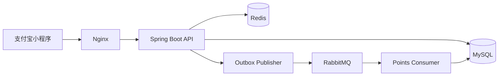

# 支付宝会议签到与互动系统

面向会议与活动现场的个人全栈项目，覆盖开发登录、会议报名、二维码/NFC统一入口令牌、定位签到、重复请求防护、异步积分和个人记录查询。项目重点展示Java后端业务建模、分布式一致性、限流与容器化验证，而不是模拟已经完成的生产上线。

## 核心能力

| 模块 | 实现 |
| --- | --- |
| 签到校验 | 会议状态、报名关系、签到窗口、点位状态、坐标范围和Haversine距离校验 |
| 双层防重 | Redis短期幂等键快速拦截；数据库`(meeting_id, user_id)`唯一约束最终兜底 |
| 异步积分 | 签到事务同时写入记录与Outbox事件，RabbitMQ异步投递，积分流水以`event_id`唯一约束消费幂等 |
| 原子限流 | Redis Lua按用户、IP和会议三个维度原子计数并设置窗口TTL |
| 可观测性 | 统一错误码、用户提示和`traceId`，保留Outbox状态及重试次数 |
| 本地交付 | Docker Compose编排MySQL、Redis、RabbitMQ、Java服务和Nginx，提供一键启动及端到端验证脚本 |

## 系统架构



签到请求先完成业务规则、限流、幂等和距离校验；数据库事务提交签到记录与Outbox事件。发布器异步投递积分事件，消费者利用事件ID唯一约束避免重复记账。

## 技术栈

- 后端：Java 21、Spring Boot 3、MyBatis-Plus、MySQL
- 中间件：Redis、RabbitMQ、Nginx
- 小程序：AXML、ACSS、JavaScript
- 工程化：Maven、JUnit 5、Docker Compose、GitHub Actions

## 一键启动

前置条件：Java 21、Maven 3.8+，以及使用Linux容器模式的Docker Desktop。

```powershell
./scripts/start-local.ps1
```

脚本会在首次运行时根据`.env.example`生成本地`.env`及随机演示密钥，自动构建后端JAR并启动全部服务，等待健康检查后执行端到端业务验证。

主要入口：

- API网关：`http://localhost:8088`
- 健康检查：`http://localhost:8088/actuator/health/readiness`
- RabbitMQ管理页：`http://localhost:15673`

开发登录码：`dev-alice`、`dev-bob`。

停止服务：

```powershell
./scripts/stop-local.ps1
```

## 验证

后端自动化测试：

```powershell
Set-Location server
mvn test
```

容器业务闭环：

```powershell
./scripts/verify-compose.ps1
```

验证覆盖开发登录、用户隔离、重复报名、正常签到、跨二维码/NFC重复签到拦截、时间窗口、会议和点位状态、距离范围、坐标边界、令牌防篡改、三维限流、Outbox重试及积分消费幂等。

## 项目结构

```text
.
├─ server/                  Spring Boot服务与自动化测试
├─ miniapp/                 支付宝小程序页面和请求封装
├─ infra/                   Nginx配置
├─ scripts/                 一键启动、停止与端到端验证脚本
├─ docs/                    API、设计、部署、验证与演示说明
└─ docker-compose.yml       本地五服务编排
```

## 文档

- [接口说明](docs/API.md)
- [系统设计](docs/DESIGN.md)
- [部署说明](docs/DEPLOYMENT.md)
- [验证记录](docs/VERIFICATION.md)
- [两分钟演示脚本](docs/DEMO_SCRIPT.md)

## 已验证边界

- 已验证：后端自动化测试、本地Docker Compose五服务、登录/报名/签到/异步积分/查询业务闭环、重复事件消费幂等和服务重启后的数据库持久化。
- 尚未验证：支付宝开放平台真实授权、支付宝开发者工具真机页面、实体NFC标签、生产环境部署、真实用户规模和正式性能压测。
- 小程序处于本地演示模式；定位不可用时会明确提示使用演示坐标，不将其表述为真机定位结果。

## 安全说明

- `.env`已加入忽略规则，仓库只保留`.env.example`占位配置。
- 一键启动脚本首次运行时生成随机本地密码和HMAC密钥。
- 不应将真实支付宝密钥、生产数据库凭据、客户数据或内部地址提交到仓库。
